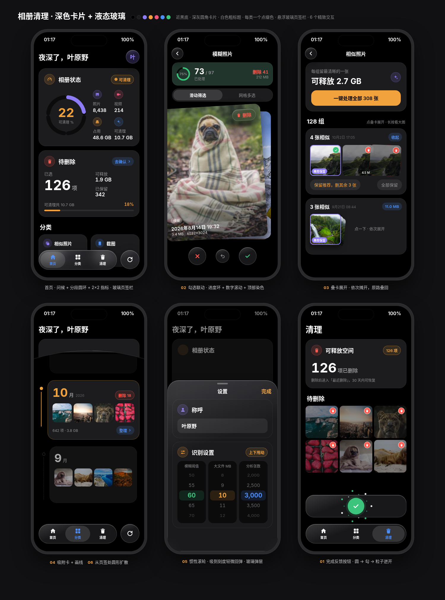

# 相册清理（iPhone App）

一个原生 iOS App（SwiftUI，iOS 16 及以上），帮你清理 iPhone 相册：自动分类 → 滑一滑挑选 → 一次性真正删除。



## 功能

| 功能 | 说明 |
|---|---|
| 智能分类 | 相似照片、截图、模糊照片、大文件、视频、过暗/过曝，首页卡片显示数量和占用空间 |
| 按月份整理 | 首页横向滑动，按月份逐月清理 |
| 滑动筛选 | 像刷卡片一样：**左滑删除、右滑保留**，带震动反馈，可撤销 |
| 相似照片 | 自动分组，推荐每组最清晰的一张（★ 最佳），一键“保留最佳，删除其余” |
| 网格多选 | 点一下标记删除，长按看大图，支持全选 |
| 确认删除 | 汇总所有待删除项和可释放空间，调用系统接口删除（系统会弹窗再确认） |
| 安全 | 全部在手机本地分析，不联网不上传；删除的照片进「最近删除」，30 天内可恢复 |

识别原理（都在本机）：
- 截图：系统自带的“截屏”标记（`PHAssetMediaSubtype.photoScreenshot`）
- 相似/重复：dHash 感知哈希 + 汉明距离；几乎相同的直接归组，比较像且拍摄时间相差 3 分钟内的也归组（连拍）
- 模糊：拉普拉斯方差（数值越小越模糊），阈值可在设置里调
- 过暗/过曝：平均亮度
- 大文件 / 视频：读取每个文件的实际大小

## 界面设计

主题：**深色健康卡片风**（近黑底 + 深灰圆角卡片），叠加 iOS 26 **液态玻璃**

- 底色 `#000`，卡片 `#1C1C1E`（圆角 24、1px 淡边），白色粗标题、灰色次要文字，强制深色模式
- 卡片标题：左侧小圆形着色图标 + 标题，右侧胶囊徽章（橙色描边「可清理」、蓝色「去确认 >」）
- 首页：按时间问候「夜深了，叶原野」（名字可在设置里改）+ 头像；分段圆环（紫色弧 + 橙色大数字）+ 2×2 指标；大数字 + 小单位；细进度条
- 克制的分类点缀色：紫 / 橙 / 粉 / 蓝 / 绿，不用渐变；红色只用于删除
- 悬浮玻璃页签栏（首页 / 分类 / 清理）+ 独立圆形操作按钮（刷新）
- 所有颜色、字号、圆角在 `PhotoCleaner/Theme/Theme.swift`

### 液态玻璃（Liquid Glass）

`PhotoCleaner/Theme/Glass.swift`：

- iOS 26：`.glassEffect(.regular.interactive())`、`GlassEffectContainer`、`glassEffectID` 形变、`.buttonStyle(.glass / .glassProminent)`
- iOS 16–25：自动退回 `.ultraThinMaterial` + 高光描边 + 柔和投影
- 用在：页签栏和圆形按钮（进入「清理」页时圆形按钮融进页签栏）、删除底栏、滑动筛选的三个圆形按钮、拖动时的「删除/保留」提示、顶部圆形按钮、设置弹层
- 参考：Apple 官方 Figma「iOS and iPadOS 26」UI Kit、Figma Community「iOS 26 UI Kit — Liquid Glass Components」

### 6 个精致交互

`PhotoCleaner/Theme/Motion.swift`（参考抖音「西瓜同学」的 6 个交互）：

| # | 交互 | 用在哪里 |
|---|---|---|
| 01 | 完成反馈按钮：按钮 → 圆 → 勾 → 粒子迸开 | 「清理」页的删除按钮 |
| 02 | 勾选联动：进度环 + 数字滚动 + 顶部底色一起变 | 分类详情页顶部；首页「待删除」卡 |
| 03 | 叠卡展开：依次摊开，原路叠回 | 「分类」页的分类卡；相似照片的每一组 |
| 04 | 吸附卡 + 画线：松手吸到最近一张，停稳后时间线画出 | 「分类」页 › 时间线（按月份） |
| 05 | 惯性滚轮：甩动减速、吸到刻度、轻微回弹 | 设置里的模糊阈值 / 大文件 / 分析张数 |
| 06 | 圆形扩散转场：从指尖处扩散铺满，返回时原路缩回 | 底部页签切换 |

预览图：`preview/mockups.png`（由 `preview/mockup.html` 生成）

> 编译需要 Xcode 26（iOS 26 SDK）。GitHub Actions 已改为 `macos-26` + `maxim-lobanov/setup-xcode`（latest-stable），App 仍支持 iOS 16 以上的手机。

## 没有 Mac，怎么装到 iPhone 上？

思路：用 GitHub 免费的 Mac 云电脑把代码编译成安装包（.ipa），再在 Windows 电脑上用 **Sideloadly** 装到 iPhone。

### 第 1 步：把代码放到 GitHub，自动生成安装包
1. 注册/登录 [github.com](https://github.com)，点右上角 **+ → New repository**，起个名字（如 `photo-cleaner`），可以选 Private，点 **Create repository**。
2. 在新仓库页面点 **uploading an existing file**，把本压缩包解压后的**所有文件和文件夹**拖进去（注意要包含 `.github` 文件夹；如果网页拖不进隐藏文件夹，可以安装 [GitHub Desktop](https://desktop.github.com) 来上传），点 **Commit changes**。
3. 打开仓库的 **Actions** 标签页，左侧选 **Build IPA**，点 **Run workflow**（上传到 main 分支后也会自动运行）。
4. 等 10 分钟左右变成绿色 ✅，点进这次运行，在页面最下方 **Artifacts** 里下载 `PhotoCleaner-unsigned-ipa`，解压得到 `PhotoCleaner-unsigned.ipa`。

### 第 2 步：用 Sideloadly 装到 iPhone（Windows）
1. 在 Windows 电脑上安装 **iTunes**（从苹果官网下载的版本，不要用微软商店版）和 **Sideloadly**（[sideloadly.io](https://sideloadly.io)）。
2. 用数据线连接 iPhone，手机上点“信任此电脑”。
3. 打开 Sideloadly：把 `PhotoCleaner-unsigned.ipa` 拖进去，**Apple ID** 一栏填你的 Apple ID（免费的就行，建议用一个不常用的小号），点 **Start**，按提示输入密码/验证码。
4. iPhone 上打开 **设置 → 隐私与安全性 → 开发者模式**，打开后手机会重启，重启后再确认一次。
5. iPhone 上打开 **设置 → 通用 → VPN与设备管理**，点你的 Apple ID，选 **信任**。
6. 回到桌面打开「相册清理」，允许访问照片（选“允许完全访问”才能清理全部照片）。

### 注意
- **免费 Apple ID 签名的 App 只能用 7 天**，到期打不开时，重新用 Sideloadly 装一次即可（照片和标记都不会丢）。Sideloadly 也可以设置自动续签。
- 免费 Apple ID 同时最多装 3 个这样的 App。
- 如果有付费开发者账号（99 美元/年），签名有效期 1 年。

## 有 Mac 的话（可选）
1. 安装 Xcode，双击打开 `PhotoCleaner.xcodeproj`（或先 `brew install xcodegen && xcodegen generate` 重新生成工程）。
2. 选中 PhotoCleaner 目标 → **Signing & Capabilities** → Team 选你的 Apple ID（Personal Team），把 Bundle Identifier 改成独一无二的，比如 `com.你的名字.photocleaner`。
3. 连上 iPhone，打开开发者模式，点 ▶ 运行；首次需在 **设置 → 通用 → VPN与设备管理** 里信任。

## 项目结构
```
project.yml                 XcodeGen 配置（工程以它为准）
PhotoCleaner.xcodeproj      由 project.yml 生成的 Xcode 工程
PhotoCleaner/
  App/        入口
  Core/       算法（dHash、拉普拉斯模糊、相似分组）和数据模型
  Services/   相册读取/删除（PhotoKit）、震动
  Store/      全局状态（扫描、分类、标记、删除）
  Views/      所有界面
PhotoCleanerTests/          算法单元测试
Package.swift               在命令行（Linux/Mac）跑同一份算法测试：swift test
.github/workflows/build-ipa.yml   GitHub 自动编译 IPA
preview/                    界面效果图
```

## 参考的开源项目
| 项目 | 参考了什么 | Star（2026-11-03 查看） |
|---|---|---|
| [qarmin/czkawka](https://github.com/qarmin/czkawka) | 相似图片查找思路（感知哈希 + 相似度阈值） | 34.8k |
| [arsenetar/dupeguru](https://github.com/arsenetar/dupeguru) | 重复文件分组、每组挑一张保留的交互 | 7.9k |
| [idealo/imagededup](https://github.com/idealo/imagededup) | 哈希去重方法 | 5.7k |
| [JohannesBuchner/imagehash](https://github.com/JohannesBuchner/imagehash) | dHash 算法 | 3.9k |
| [jenssegers/imagehash](https://github.com/jenssegers/imagehash) | dHash 实现 | 2.1k |
| [WillBrennan/BlurDetection2](https://github.com/WillBrennan/BlurDetection2) | 拉普拉斯方差模糊检测 | 390 |
| [dev-nick421/immich-swipe](https://github.com/dev-nick421/immich-swipe) | 左滑删除/右滑保留交互 | 247 |
| [chrisdanford/Tidy](https://github.com/chrisdanford/Tidy) | iOS 端相册空间清理思路 | 44 |
| [360ghar/tidybyte](https://github.com/360ghar/tidybyte) | iOS 滑动清理 + 找重复 | 16 |
